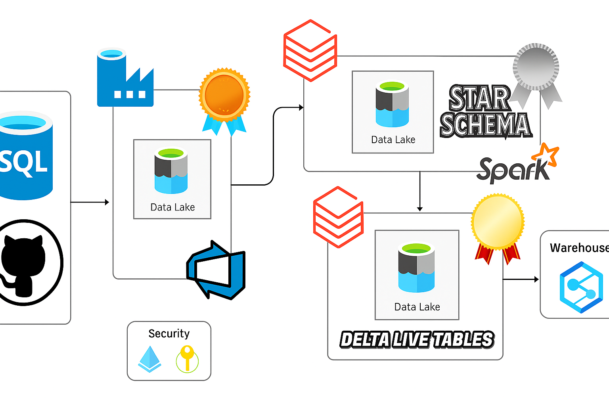
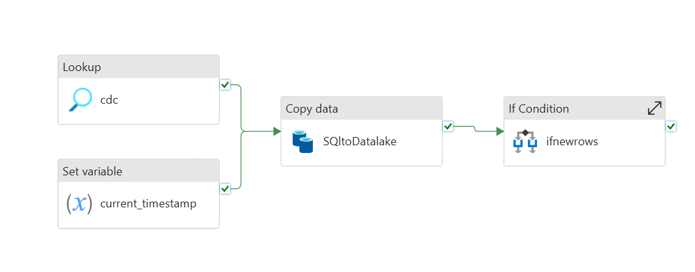
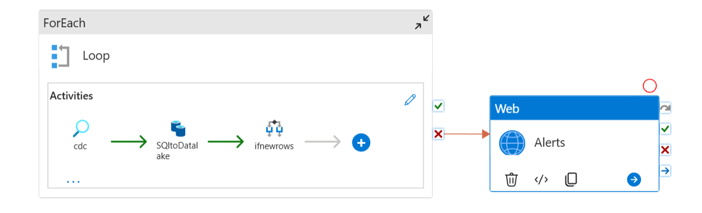
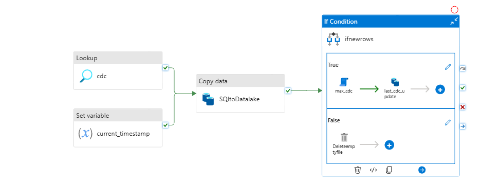
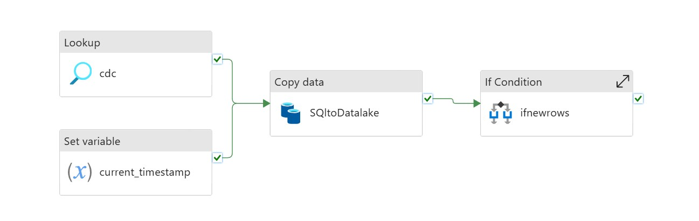

# Apple Music Lakehouse Pipeline on Azure

> **Learning project:** Hands-on Azure data engineering practice project built by [Prakash Kantumutchu (KP)](https://thisiskp.in) to explore watermark-based incremental ingestion in Azure Data Factory, medallion storage on Azure Data Lake Storage Gen2, and Databricks transformation notebooks.

---

## Overview

This repository contains the Azure Data Factory (ADF) definitions, SQL setup scripts, and Databricks notebook archive (`dab.dbc`) for an Apple Music streaming analytics pipeline following a Bronze / Silver / Gold medallion design:

1. **Incremental ingestion (Azure Data Factory):**
   - `pipeline/Incremental_ingestion.json` reads a high-water mark (`cdc.json`), queries new/updated rows from Azure SQL Database, writes Parquet files to ADLS Gen2, and updates the watermark only when new rows are copied.
   - `pipeline/incremental_loop.json` wraps the incremental copy pattern in a metadata-driven `ForEach` loop (`loop_input`) across multiple source tables, with a failure alert webhook activity.
2. **Transformation (Azure Databricks):**
   - `dab.dbc` contains the Databricks notebook archive used to read Bronze Parquet files from ADLS Gen2 and transform them into Silver and Gold Delta tables.
3. **ARM templates:**
   - `adf-musicdataproject/` holds the exported Azure Resource Manager templates and parameter files generated by ADF Git integration.

---

## Architecture Diagrams

### End-to-End Medallion Flow


### ADF Watermark & CDC Ingestion Flow


### Metadata-Driven ForEach Orchestration


### Incremental Copy Activity Views




---

## Repository Contents

```text
├── adf-musicdataproject/               # Exported ADF ARM templates & parameters
│   ├── ARMTemplateForFactory.json
│   ├── ARMTemplateParametersForFactory.json
│   ├── globalParameters/
│   └── linkedTemplates/
├── assets/                             # Pipeline & architecture screenshots
│   ├── arch.png
│   ├── 1.png
│   ├── 2.png
│   ├── 3.png
│   └── 4.jpg
├── dataset/                            # ADF dataset definitions
│   ├── AzureSql.json
│   ├── Parquet1.json
│   ├── Parquet_dynamic.json
│   └── json_dynamic.json
├── factory/
│   └── adf-musicdataproject.json       # ADF factory resource metadata
├── linkedService/                      # ADF linked services (Azure SQL + ADLS Gen2)
│   ├── AzureDataLakeStoragels.json
│   └── sqldbls.json
├── pipeline/                           # ADF pipeline definitions
│   ├── Incremental_ingestion.json
│   └── incremental_loop.json
├── cdc.json                            # Initial watermark state file
├── empty.json                          # Empty watermark template
├── initial_load.sql                    # SQL script for initial source table creation/load
├── incremental_load.sql                # SQL script for testing incremental row inserts
├── loop_input                          # Table configuration input for ForEach pipeline
├── dab.dbc                             # Databricks notebook archive
├── publish_config.json                 # ADF publish branch configuration
└── LICENSE                             # GPL-3.0
```

---

## License

GNU General Public License v3.0 — see [`LICENSE`](LICENSE).
